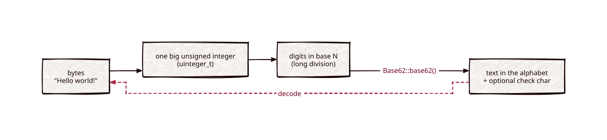

# base-x

Part of [Kronuz C++ Libraries](https://github.com/Kronuz/cpp-libraries), a collection of small, reusable C++ libraries.

[](https://github.com/Kronuz/base-x/actions/workflows/ci.yml)
[](LICENSE)


Encode and decode binary data in any base from 2 to 66, in C++17: base58,
base62, base32 Crockford, base64, and dozens more, with optional check
characters. For compact, human-friendly IDs, keys, and hashes.



## ✨ Highlights

- **Any alphabet.** Ready-made Bitcoin, Ripple, and Flickr base58, base62,
  Crockford base32, URL-safe base64, the RFC 4648 variants, and more; or bring
  your own.
- **Check characters.** The `*chk()` alphabets append a check character that
  catches transcription errors; `is_valid` tests without decoding.
- **Forgiving decoding.** Case-insensitive alphabets and translated look-alikes:
  Crockford base32 reads `O` as `0`, `I` and `L` as `1`, and skips `-`.
- **Standard output when you need it.** The `rfc4648()` presets produce padded,
  byte-aligned hex, base32, and base64, byte for byte what Python's `base64` module
  writes, leading zero bytes included.
- **Header-only**, on [uinteger_t](https://github.com/Kronuz/uinteger_t)'s
  arbitrary-precision integers.

## 📦 Installation

Requires a C++17 compiler; CMake 3.14 or newer for the CMake route, which fetches
`uinteger_t` for you. CI builds it on Linux (x86_64, arm64), macOS (arm64,
x86_64), and FreeBSD, plus ASan, UBSan, and TSan builds.

```cmake
include(FetchContent)
FetchContent_Declare(base_x
  GIT_REPOSITORY https://github.com/Kronuz/base-x.git
  GIT_TAG        master)
FetchContent_MakeAvailable(base_x)

target_link_libraries(my_app PRIVATE base_x::base_x)   # brings uinteger_t along
```

Without CMake, put both `base_x.hh` and `uinteger_t.hh` on your include path.

## 🚀 Quick start

```cpp
#include "base_x.hh"

#include <iostream>

int main() {
	auto id = Base62::base62().encode("Hello world!");    // "T8dgcjRGuYUueWht"
	std::cout << id << '\n' << Base62::base62().decode(id) << '\n';

	auto checked = Base62::base62chk().encode("Hello world!");
	std::cout << Base62::base62chk().is_valid(checked) << '\n';   // 1

	std::cout << Base32::crockford().encode(519571) << '\n';      // "FVCK"
}
```

[`examples/demo.cc`](examples/demo.cc) tours the alphabets, check characters,
and RFC 4648 padding.

## 🎯 When to use it

- ✅ Short, readable, URL-safe identifiers, with the exact alphabet you choose.
- ❌ Interchange with `xxd` or a stock base64 library through the plain
  `base16()`/`base64()` alphabets: they encode the input as one integer. Use the
  `rfc4648()` presets.
- ❌ Bitcoin-compatible base58check of arbitrary bytes: leading zero bytes are not
  kept as leading characters (the `rfc4648()` presets do keep them).
- ❌ Streaming data larger than memory: the whole value is converted at once.

## ⚡ Performance

Nanoseconds per base58 call on an Apple M1 Pro (Apple clang 21, `-O2`), the best of seven
rounds of [`bench/bench.cc`](bench/bench.cc), against [Firedancer](https://github.com/firedancer-io/firedancer)'s
fixed-size codec (32 and 64 bytes only) and [libbase58](https://github.com/bitcoin/libbase58).
`encode` and `decode` return a new `std::string`; the "into a string" column writes into one
string that keeps its capacity, as the other codecs write into a caller's buffer.

| bytes | operation | base-x | into a string | Firedancer | libbase58 |
|---:|---|---:|---:|---:|---:|
| 32 | encode | 74.3 | 52.0 | 48.5 | 2,086 |
| 32 | decode | 71.6 | 51.6 | 63.3 | 496 |
| 64 | encode | 134 | 114 | 112 | 9,300 |
| 64 | decode | 98.2 | 78.2 | 198 | 1,749 |
| 256 | encode | 806 | 774 | - | 159,990 |
| 256 | decode | 537 | 507 | - | 14,182 |

On an Intel Core i9-9980HK (Apple clang 17, same flags) base-x encodes in about twice
Firedancer's time (32 bytes: 144 ns against 70) and decodes 64 bytes in about the same time
(277 ns against 287).

## 📚 Documentation

- [docs/API.md](docs/API.md): `encode`, `decode`, `is_valid`, every built-in
  alphabet, and the caveats.
- [ARCHITECTURE.md](ARCHITECTURE.md): how the codec, check digits, and padding
  work.
- [CHANGELOG.md](CHANGELOG.md): what changed, by date.
- [AGENTS.md](AGENTS.md): repository map and traps.

## 🛠️ Building and testing

```sh
cmake -B build && cmake --build build && ctest --test-dir build
./build/base_x_demo
```

The tests use `assert`, so build without `NDEBUG`.

[`bench/bench.cc`](bench/bench.cc) times encode and decode at 16 to 1024 bytes
(`c++ -std=c++17 -O2 -I. -I<uinteger_t> bench/bench.cc -o bench && ./bench`) and can compare
base58 with libbase58 and Firedancer; the build lines are at the top of the file. It is
not a CTest target.

## 🤝 Contributing

Issues and pull requests are welcome. Read [AGENTS.md](AGENTS.md) first. CI must
pass on every platform.

## 📄 License

MIT, Copyright (c) 2017-2026 Germán Méndez Bravo. See [LICENSE](LICENSE).
